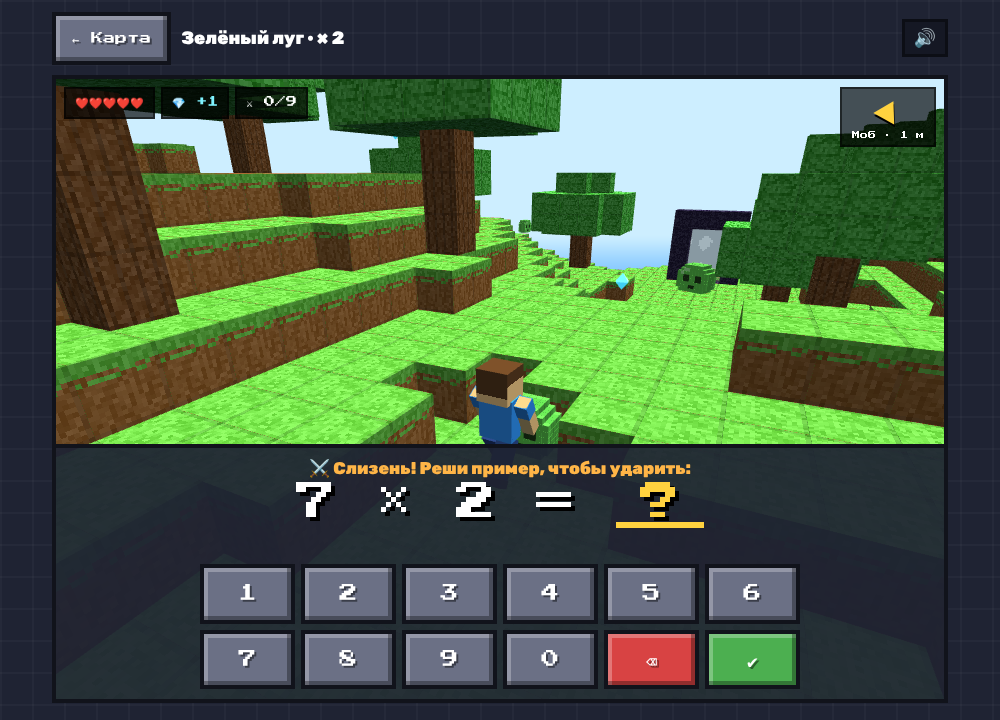
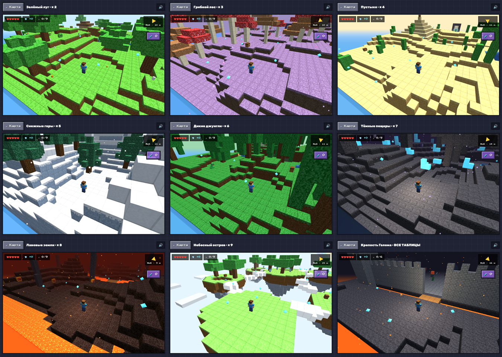
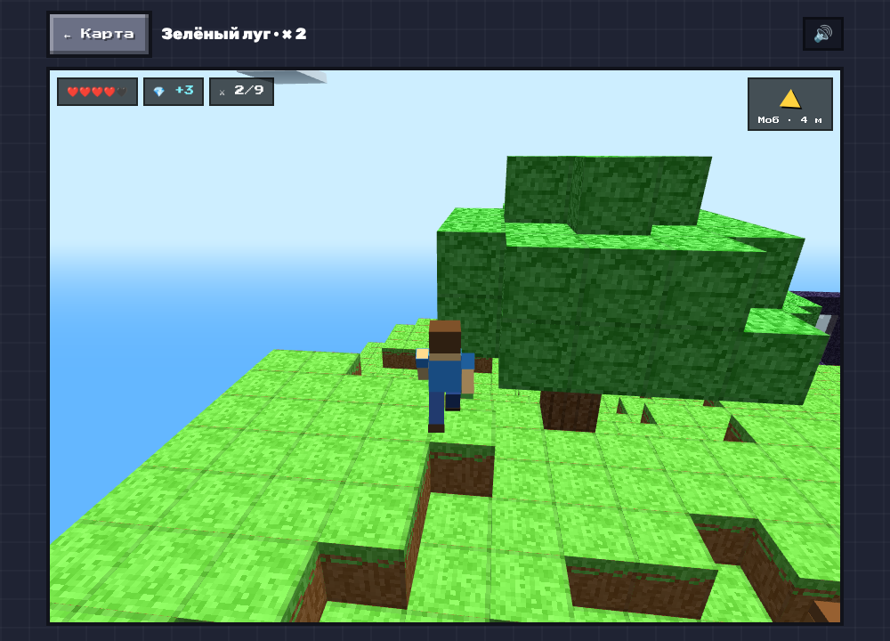
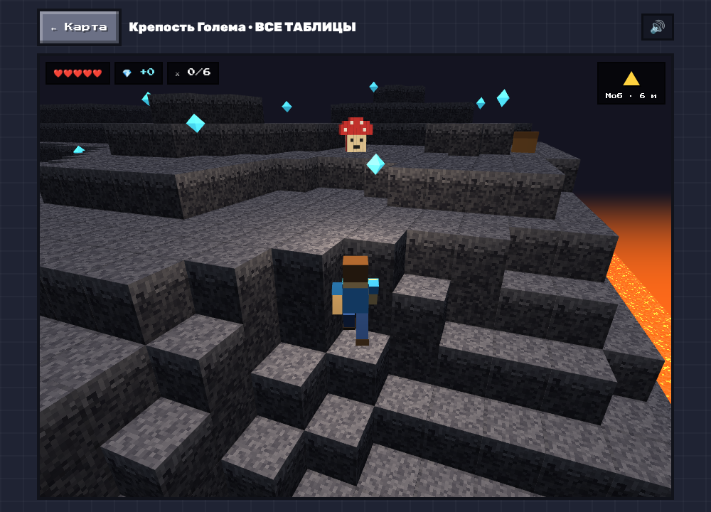
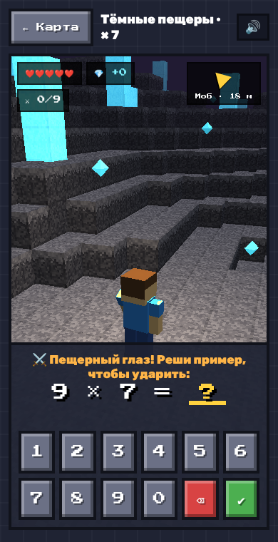

# 🧱 Блокоград: Мастер умножения

**Бесплатная 3D-игра в браузере, которая помогает детям выучить таблицу умножения.**
Блочный мир, мобы, сундуки, кристаллы и порталы, а сила героя зависит от умножения.

### ▶️ [Играть онлайн](https://shav5544-cmd.github.io/blokograd/)

Установка не нужна. Работает в браузере на компьютере, планшете и телефоне.



---

## Почему это работает

Детям 8–11 лет, которые любят блочные игры, обычная зубрёжка скучна. В Блокограде каждый пример превращается в удар мечом:

- **Подошёл к мобу**, на экране появляется пример. Ответ верный — герой бьёт, моб рассыпается на блоки.
- **Ошибся** — моб бьёт в ответ, но сразу показывается подсказка-трюк, например *«×9 = ×10 − число»* или *«5, 6, 7, 8 → 56 = 7×8»*.
- **Умное повторение.** Примеры, на которых ребёнок ошибается, попадаются чаще, а выученные реже.
- **Карта знаний 10×10** зеленеет по мере того, как ребёнок осваивает примеры. Видно, что осталось выучить.
- **Через 20 минут игра сама предложит сделать перерыв.**

## Что внутри

| | |
|---|---|
| 🏝 **9 разных миров** | луг с рекой и домиками, грибной лес, пустыня с пирамидой, снежные горы, джунгли с храмом, пещера, лавовые земли, небесные острова и крепость Голема |
| ⚔️ **Мобы** | Слизень, Грибень, Кактусоид, Снеговик-хулиган, Лиана-змей, Пещерный глаз, Лавовый куб, Облачный дракончик |
| 🎁 **Сундуки и кристаллы** | на холмах и верхушках деревьев |
| 🛡 **Стражи порталов** | защищены щитом, пока не побеждены все мобы острова |
| 🌀 **Порталы** | открываются после победы над стражем |
| ⛏ **Шахта** | добыть как можно больше блоков за 60 секунд |
| 🛒 **Магазин** | питомцы, которые бегают за героем, мечи, зелья жизни, одежда и шапки |
| 📜 **Сертификат** | «Мастер умножения» с именем ребёнка за победу над Големом |
| 🧍 **5 героев** | Макс, Лея, Тимур, Рыжик и Ниндзя |
| 👥 **Игра вдвоём** | друг подключается по 6-значному коду, вы вместе проходите остров и можете говорить через микрофон 🎤 |
| 💾 **Сохранение** | перенос прогресса между устройствами по коду |
| 🏆 **Достижения** | комбо, серии дней, «Мастер умножения» |






## Управление

| Компьютер | Телефон и планшет |
|---|---|
| `W A S D` или стрелки — идти | левый палец — джойстик |
| `Пробел` — прыжок | кнопка ▲ — прыжок |
| зажать мышь и двигать — камера | правый палец — камера |
| цифры и `Enter` — ответ | кнопки на экране |



## Для родителей

- Без рекламы, регистрации и покупок.
- Прогресс сохраняется в браузере на этом устройстве.
- Нужен интернет: 3D-движок [three.js](https://threejs.org) загружается с CDN.
- Весь код в одном файле `index.html`, его можно открыть и проверить.

## 🇺🇿 Ўзбекча

**Блокоград** — болаларга кўпайтириш жадвалини ўйин орқали ўргатадиган бепул 3D браузер ўйини. Қаҳрамон блокли оролларда юради, мобларга дуч келади ва уларни мисол ечиб енгади. Хато қилса, ўша мисолни осон эслаб қолиш усули кўрсатилади. Ўйин тили рус тилида.

👉 **[Ўйнаш](https://shav5544-cmd.github.io/blokograd/)**

## Как запустить у себя

```bash
git clone https://github.com/shav5544-cmd/blokograd.git
cd blokograd
# просто откройте index.html в браузере
```

## Лицензия

MIT. Пользуйтесь, делитесь, улучшайте. Персонажи и мир придуманы для этой игры.

---

⭐ Если игра помогла вашему ребёнку, поставьте звезду и расскажите другим родителям!
